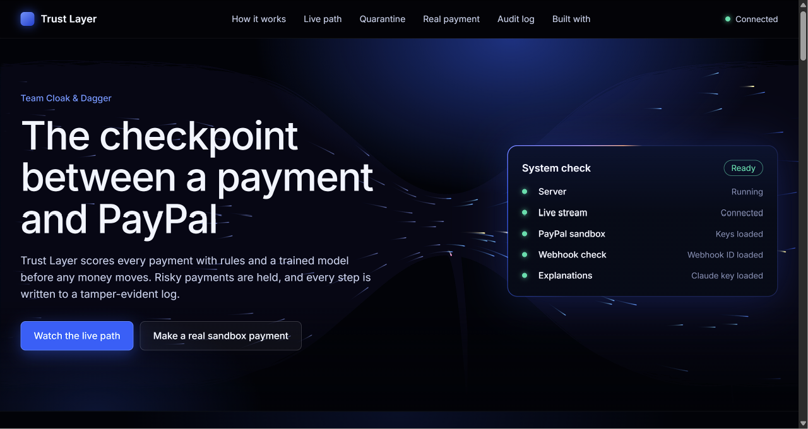
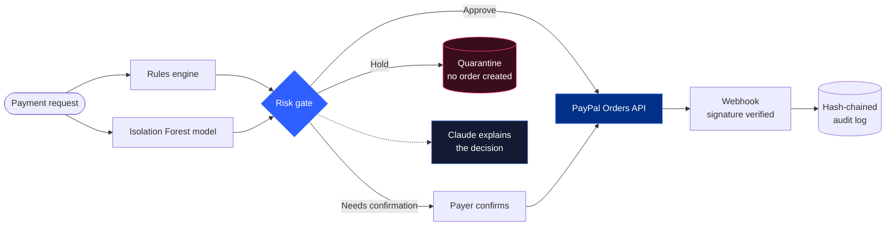
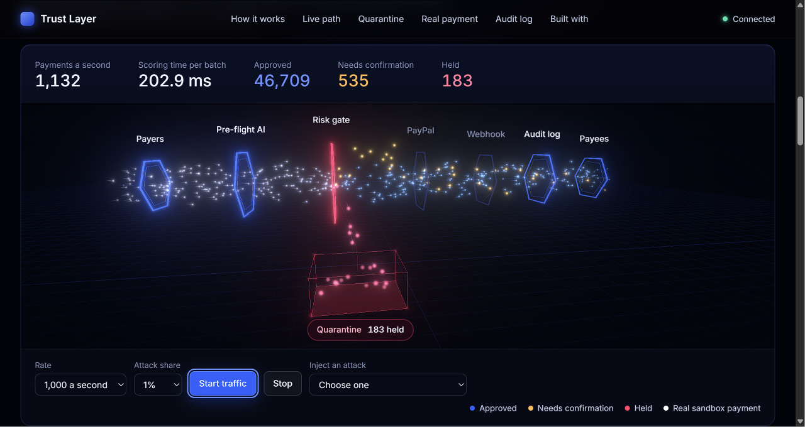
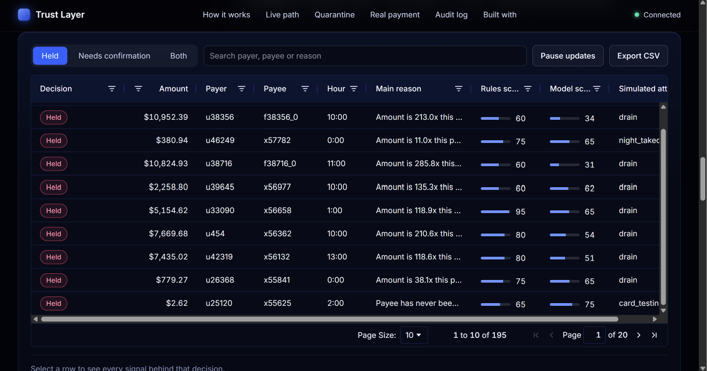

<div align="center">

# Trust Layer

### The checkpoint between a payment and PayPal

Every payment is scored by rules and a trained model **before any money moves**.<br/>
Risky payments are held before a PayPal order exists, and every step is written to a tamper-evident log.

<br/>

[](https://paypal-trust-layer-1.onrender.com)
[](REPLACE_WITH_YOUTUBE_URL)


<br/>

**Team Cloak & Dagger** &nbsp;|&nbsp; Aayush and Riya<br/>
Built for the *Build What's Next with PayPal and AI* hackathon

</div>

<br/>

<!-- SCREENSHOT: save a screenshot of the hero as docs/hero.png, or delete the next line -->


> **Note for judges:** the demo runs on Render's free tier. The backend sleeps when idle, so the first load can take about a minute. The stack and the list of what is simulated are at [the Built with section](https://paypal-trust-layer-1.onrender.com/#built).

<br/>

## Contents

- [The problem](#the-problem)
- [What Trust Layer does](#what-trust-layer-does)
- [How a payment travels](#how-a-payment-travels)
- [Features](#features)
- [How PayPal is used](#how-paypal-is-used)
- [How AI is used](#how-ai-is-used)
- [Measured results](#measured-results)
- [Honest limits](#honest-limits)
- [Run it yourself](#run-it-yourself)
- [Project layout](#project-layout)
- [Team](#team)
- [License](#license)

<br/>

## The problem

Once a payment is sent, getting the money back is slow and uncertain. Account takeovers and unusual payments are usually noticed after the damage is done.

This gets more urgent as AI agents begin to make payments for people, because an agent can be tricked into paying the wrong party.

**Our answer:** move the decision to the one moment where stopping a payment costs nothing, which is before the PayPal order exists.

<br/>

## What Trust Layer does

It sits in front of PayPal and gives every payment one of three outcomes.

| Decision | What happens |
|:--|:--|
| **Approve** | A real PayPal order is created and can be captured. |
| **Needs confirmation** | The order is created, but capture is refused until the payer confirms. |
| **Hold** | Nothing is sent to PayPal. No order exists, so there is nothing to refund. |

<br/>

## How a payment travels



1. **Score.** Fixed rules and an Isolation Forest model each score the payment.
2. **Decide.** The stricter of the two wins. The model can raise a payment to "needs confirmation" but cannot block one alone.
3. **Pay.** Approved payments go to the PayPal Orders v2 API (sandbox).
4. **Verify.** PayPal's webhook is signature-checked, and its amount is compared with what was approved.
5. **Record.** Every decision, order, capture and webhook is written to a hash-chained audit log.
6. **Explain.** Claude turns the risk facts into plain language. It explains decisions and cannot change them.

<br/>

## Features

| | Feature | What you can do |
|:-:|:--|:--|
| 1 | **Live 3D payment path** | Watch simulated traffic flow through the real scoring engine. Held payments turn red and drop into quarantine. |
| 2 | **Quarantine table** (AG Grid) | Sort, filter, search, page and export flagged payments, with every reason behind each decision. |
| 3 | **AI incident note** | The server counts what recent holds have in common, and Claude writes a short analyst note from those counts. |
| 4 | **Real PayPal sandbox payments** | Create, approve and capture a real sandbox order, with a four-step progress view ending in "Webhook verified". |
| 5 | **Tamper-evident audit log** (AG Grid) | Each entry holds the SHA-256 hash of the one before it. Edit an old entry and watch the break get detected. |
| 6 | **Safe PayPal calls** | Token caching, retries with backoff, idempotency keys so a retry can never charge twice, and a capture state machine that blocks double captures. |
| 7 | **Rate limits and input checks** | On every public endpoint. |
| 8 | **Live system check** | The page shows whether the server, stream, PayPal keys, webhook and Claude are ready. |

<!-- SCREENSHOTS: save these two images in docs/, or delete this table -->
| Live payment path | Quarantine and AI incident note |
|:-:|:-:|
|  |  |

<br/>

## How PayPal is used

| PayPal capability | Where in the code |
|:--|:--|
| OAuth 2.0 client credentials | `backend/get_token.py` |
| Orders v2: create and capture | `backend/payments.py` |
| `PayPal-Request-Id` idempotency keys | `backend/payments.py` |
| Webhooks and `verify-webhook-signature` | `backend/webhooks.py` |

PayPal is the centre of the project: nothing reaches it until Trust Layer has decided, and nothing is trusted from it until its signature is verified.

<br/>

## How AI is used

| Tool | Role in the product |
|:--|:--|
| **scikit-learn Isolation Forest** | Scores how unusual each payment is compared with normal behaviour. Four features: amount relative to the payer's average, new payee, hour, and payment velocity. |
| **Claude** (Anthropic API, `claude-haiku-5-5`) | Writes the plain-language explanation of each decision, and the incident note in Quarantine. If the API is unavailable, a built-in template is used and the page says so. |

**AI explains, it does not decide.** Claude is given only facts built by the server, wrapped in `<facts>` tags, and is told the decision is already made. It never receives free text from a payer, so a prompt-injection attempt cannot talk a payment through.

**AI used during development:** Claude was used as a coding assistant while building this project. It helped write and review code, and explain each component.

### Sponsor tools

| Tool | Use |
|:--|:--|
| **AG Grid** | The quarantine table (sorting, filters, search, paging, CSV export, custom cells) and the audit log table. |
| **Render** | Hosts the backend as a Web Service and the dashboard as a Static Site. |

<br/>

## Measured results

Model evaluation on held-out synthetic data, printed by `train_model.py`:

| Attack type | Caught by rules | Caught by model | Caught by either |
|:--|:-:|:-:|:-:|
| Account drain | 99.9% | 77.1% | **99.9%** |
| Card testing | 100.0% | 88.7% | **100.0%** |
| Night takeover | 100.0% | 97.0% | **100.0%** |
| Moderate anomaly | 81.0% | 82.8% | **83.2%** |
| Scam payment | 0.0% | 9.9% | **9.9%** |

- **False positives** on normal payments: 1.28%
- **Scoring speed** on a laptop with simulated load: about 1,000 payments a second at 85 ms p99, and about 5,000 a second at 124 ms p99
- **Automated checks:** 25 hardening checks, plus decision, engine and webhook tests

<br/>

## Honest limits

We would rather state these than have a judge find them.

- **The traffic is simulated.** Only payments made in the Real payment section are real PayPal sandbox activity.
- **The model is trained on synthetic data** and has four features. It has not seen real fraud.
- **Scam payments are mostly missed.** A scam looks like a normal payment to a new payee, and these signals cannot tell them apart.
- **Orders and decisions are kept in memory** and are lost when the server restarts.
- **The audit log is tamper-evident, not tamper-proof.** It detects changes but cannot prevent them. On Render's free tier the log file resets on restart.
- **Demo endpoints are open.** The simulator and tamper buttons have no login.

<br/>

## Run it yourself

You need Python 3.11 or newer, Node.js 20 or newer, and a free [PayPal Developer](https://developer.paypal.com) account.

### 1. PayPal sandbox setup

1. In the PayPal Developer Dashboard, create a sandbox app and copy its Client ID and Secret.
2. Make sure you have one sandbox **Business** account (the seller) and one **Personal** account (the buyer).
3. Optional, for webhooks: add a webhook pointing at `https://YOUR-PUBLIC-URL/webhooks/paypal`, subscribe to the checkout order and payment capture events, and copy the Webhook ID. Locally you can expose port 8000 with a tunnel such as ngrok.

### 2. Backend

```bash
cd backend
pip install -r requirements.txt
cp ../.env.example ../.env      # then fill in your values
python train_model.py           # trains and saves the model
uvicorn main:app --port 8000
```

### 3. Dashboard

```bash
cd dashboard
npm install
npm run dev
```

Open http://localhost:5173.

### 4. Try it

| Step | Where | What to do |
|:-:|:--|:--|
| 1 | Live path | Press **Start traffic**, then inject an **Account drain**. |
| 2 | Quarantine | Sort the table and press **Summarise the recent holds**. |
| 3 | Real payment | Choose **Normal payment**, approve it as the sandbox buyer in a private window, then capture it. |
| 4 | Real payment | Choose **Drain at 3 AM** and see it held before PayPal is called. |
| 5 | Audit log | Press **Simulate tampering**, watch the chain break, then **Undo tampering**. |

### Tests

```bash
python backend/test_decision.py     # decision logic
python backend/test_engine.py       # batch engine matches single scoring
python backend/test_webhooks.py     # forged, valid, duplicate and mismatched webhooks
python backend/test_hardening.py    # 25 checks: retries, idempotency, capture safety, limits
```

### Configuration

| Variable | Needed | Purpose |
|:--|:--|:--|
| `PAYPAL_CLIENT_ID`, `PAYPAL_CLIENT_SECRET` | Yes | Sandbox app credentials |
| `PAYPAL_BASE_URL` | Yes | `https://api-m.sandbox.paypal.com` |
| `PAYPAL_WEBHOOK_ID` | For webhooks | ID of the webhook that points at this server |
| `ANTHROPIC_API_KEY` | Optional | Enables Claude explanations |
| `ALLOWED_ORIGINS` | When deployed | Dashboard address allowed to call the API |
| `EXPLAIN_MODEL`, `MAX_SIM_RATE`, `AUDIT_DB` | Optional | Model name, simulator cap, audit file path |
| `VITE_API_URL` (dashboard) | When deployed | Address of the backend |

<br/>

## Project layout

```
backend/
  main.py            API: orders, capture, webhooks, health
  risk.py            rules engine
  ml_risk.py         Isolation Forest scoring
  decision.py        combines rules and model
  payments.py        PayPal Orders calls with retries and idempotency
  webhooks.py        webhook signature verification
  audit.py           hash-chained audit log
  explain.py         Claude explanations
  incident.py        Claude incident note
  stream.py          traffic simulator and WebSocket
  engine.py          fast batch scoring
dashboard/src/
  App.tsx            the page
  Hero.tsx           hero and system check
  Scene3D.tsx        the 3D live path (with flow3d.ts)
  QuarantineGrid.tsx AG Grid quarantine table
  RealPayment.tsx    real sandbox payment flow
  AuditLog.tsx       AG Grid audit table
```

<br/>

## Team

**Team Cloak & Dagger** built Trust Layer for the *Build What's Next with PayPal and AI* hackathon.

| Member | GitHub |
|:--|:--|
| **Aayush** | [@aayush-sah](https://github.com/aayush-sah) |
| **Riya** | [@riyaagarwal001](https://github.com/riyaagarwal001) |

<br/>

## Acknowledgements

- **PayPal Developer** for the sandbox, the Orders v2 API and webhooks.
- **Anthropic** for Claude, which writes the explanations and incident notes.
- **AG Grid** for the tables, and **Render** for hosting.

<br/>

## License

Released under the [MIT License](LICENSE). You are free to use, change and share this code.

<br/>

<div align="center">

### See it running

[](https://paypal-trust-layer-1.onrender.com)

[What it is built with](https://paypal-trust-layer-1.onrender.com/#built) &nbsp;|&nbsp; [Watch the demo video](REPLACE_WITH_YOUTUBE_URL)

<br/>

Made by **Aayush** and **Riya**, Team Cloak & Dagger

</div>